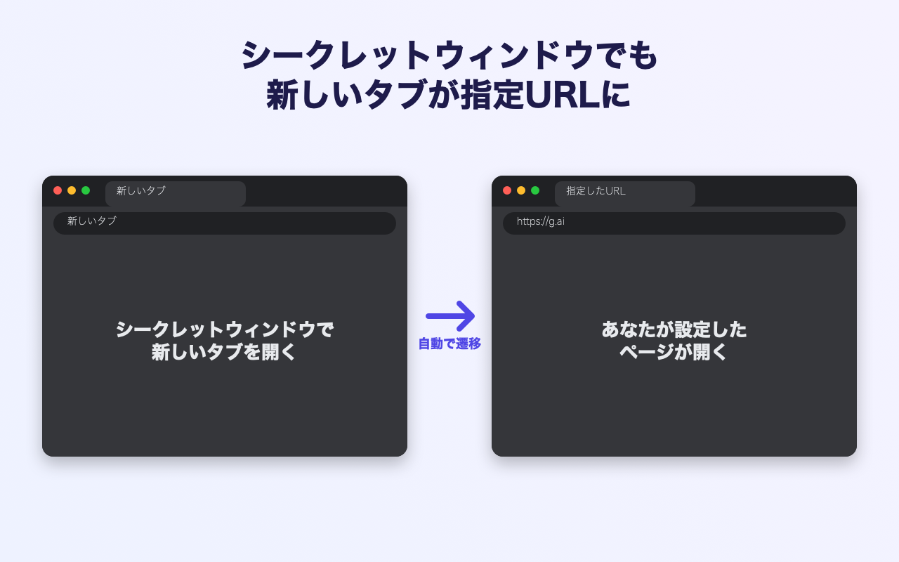
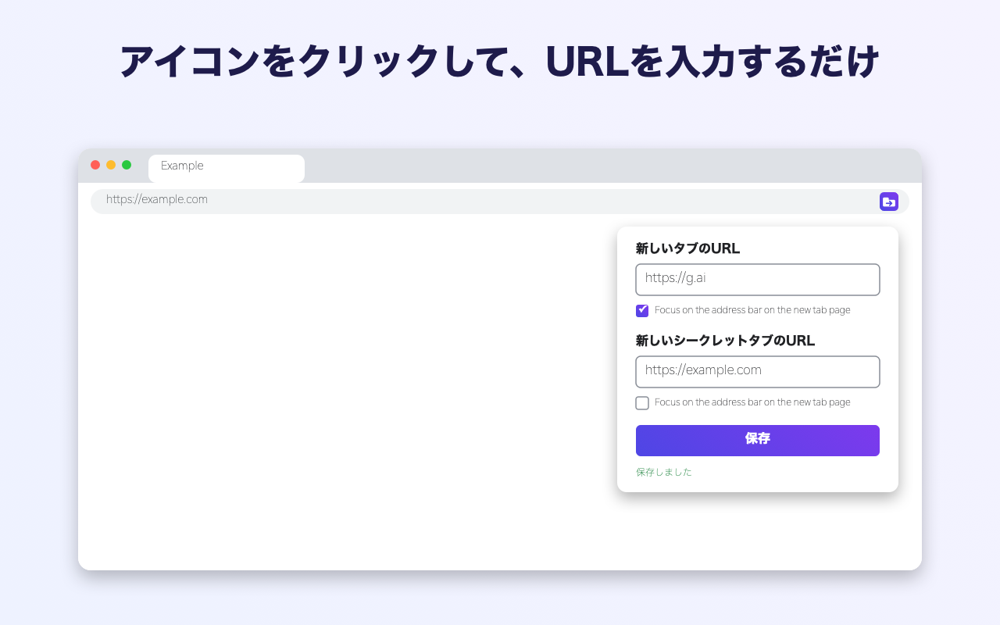

# Custom New Tab (Incognito)

新しいタブを好きなURLに置き換える Chrome 拡張機能です。**シークレットウィンドウの新しいタブにも対応**します。

Chrome の仕様で、拡張機能は `chrome_url_overrides.newtab` によるシークレットウィンドウの新しいタブの上書きができません。
この拡張機能は通常ウィンドウでは上書き、シークレットでは新しいタブ(`chrome://newtab/`)を検知して指定URLへ遷移させることで両方に対応します。

## インストール

Chrome ウェブストアの公開枠の都合で、GitHub から手動インストールしてください。

1. [Releases](../../releases/latest) から `custom-new-tab-incognito-*.zip` をダウンロードして展開
2. `chrome://extensions` を開き、右上の「デベロッパー モード」をオン
3. 「パッケージ化されていない拡張機能を読み込む」で展開したフォルダを選択
4. シークレットで使う場合は、拡張機能の「詳細」→「シークレット モードでの実行を許可」をオン

## 使い方

ツールバーのアイコンをクリックし、ポップアップにURLを入力して「保存」(Enter でも可)。初期値は `https://g.ai` です。

「Focus on the address bar on the new tab page」で、新しいタブを開いたときにアドレスバーへフォーカスを残すかを切り替えられます(初期値: オン)。オフにすると遷移先のページにフォーカスが移ります。シークレットウィンドウでの効果は未検証です。

## 権限

| 権限 | 用途 |
|------|------|
| `storage` | 設定したURLの保存 |
| `tabs` | シークレットで開かれた新しいタブの検知・遷移 |

データの収集・外部送信は一切行いません。

## 注意

- シークレットでは新しいタブが一瞬表示されてから指定URLに切り替わります
- 他の新しいタブ上書き拡張機能と併用すると競合します
- Chrome 145 以降の挙動変更により、将来シークレットでの遷移が動かなくなる可能性があります
- 本拡張機能は dictanote の「Custom New Tab」とは無関係の独立した実装です

## ライセンス

MIT
